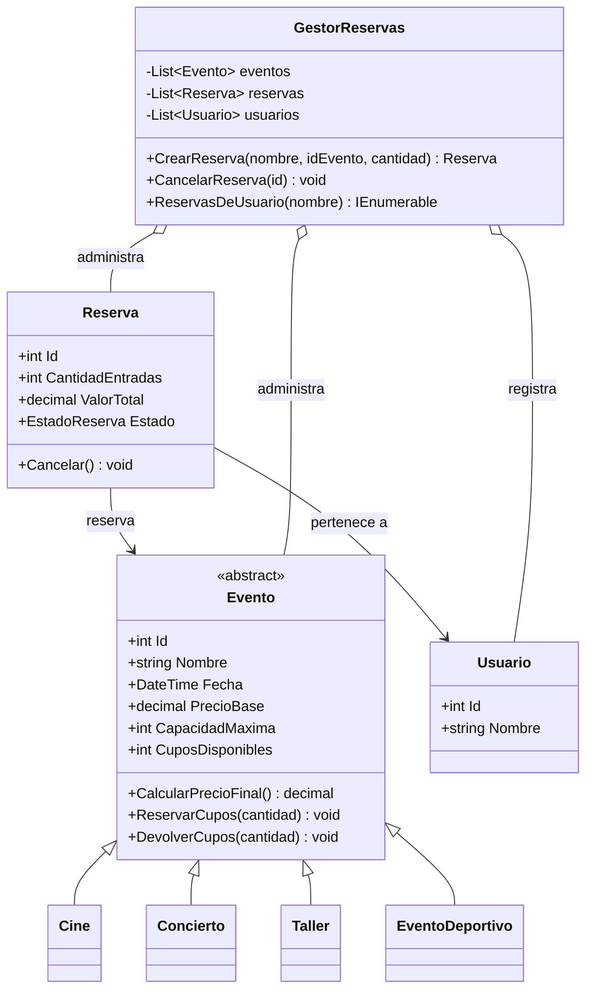

# PLANAZO — Gestión de eventos y reservas

Aplicación de consola desarrollada en C# y .NET para consultar eventos, calcular precios, reservar entradas, cancelar reservas y consultar un resumen de las reservas activas.

## Requisitos
- .NET 8 SDK o superior compatible.
- Terminal o Visual Studio Code.

## Cómo ejecutar
1. Clona o descarga este repositorio.
2. Abre una terminal en la carpeta raíz del proyecto, donde está `PLANAZO-POO-CSharp.csproj`.
3. Ejecuta:

```bash
dotnet run
```

## Funcionalidades
- Inicia con dos eventos de cine, dos conciertos, dos talleres y un evento deportivo adicional.
- Consulta la lista de eventos y los detalles por identificador.
- Calcula el precio final: cine conserva el precio base, concierto aplica 15 % de recargo, taller aplica 10 % de descuento y evento deportivo aplica 8 % de recargo.
- Crea reservas validando persona, cantidad y disponibilidad.
- Descuenta cupos al reservar y los devuelve al cancelar.
- Evita cancelar dos veces una misma reserva.
- Lista reservas y resume reservas activas, entradas activas y valor total activo.
- Permite consultar las reservas asociadas a una persona.
- Maneja errores de entradas y operaciones sin cerrar intencionalmente el menú.

## Clases y relaciones
- `Evento`: clase abstracta con datos comunes, validación y control de cupos. Declara `CalcularPrecioFinal()` como método abstracto.
- `Cine`, `Concierto`, `Taller`: heredan de `Evento` e implementan su propia fórmula de precio.
- `EventoDeportivo`: clase adicional que hereda de `Evento` y aplica un recargo del 8 %.
- `Usuario`: representa a la persona que realiza reservas.
- `Reserva`: vincula un `Usuario` con un `Evento`, registra cantidad, valor total y estado.
- `GestorReservas`: mantiene las colecciones de eventos y reservas, crea usuarios cuando se necesitan y coordina las operaciones.
- `Program.cs`: contiene el menú y solicita datos; delega la lógica a `GestorReservas` y a los modelos.

## Conceptos de POO aplicados
- **Clases y objetos:** los eventos, usuarios y reservas se representan con clases e instancias.
- **Constructores:** inicializan los objetos y validan datos esenciales.
- **Encapsulamiento:** los cupos se modifican mediante `ReservarCupos` y `DevolverCupos`; el estado de reserva cambia mediante `Cancelar`.
- **Abstracción:** `Evento` define los datos y comportamientos comunes sin fijar una fórmula única de precio.
- **Herencia:** los tipos concretos de evento heredan de `Evento`.
- **Polimorfismo:** todos los eventos responden a `CalcularPrecioFinal()`, pero cada subtipo aplica una regla distinta.
- **Asociación/composición:** `Reserva` se relaciona con un `Usuario` y un `Evento`; `GestorReservas` administra listas de objetos.
- **Colecciones:** se usan `List<Evento>`, `List<Reserva>` y `List<Usuario>`.
- **Excepciones:** validaciones y errores como identificadores inexistentes, cantidades inválidas, cupos insuficientes o cancelaciones repetidas se controlan y muestran al usuario.
- **Dinero:** los importes se manejan con `decimal`.

## Diagrama de clases UML



## Casos de prueba para evidenciar en capturas
Ejecuta `dotnet run` y guarda las capturas reales en la carpeta `Capturas/`. Procura mostrar la entrada introducida y el resultado que aparece en consola.

1. **Reserva válida:** opción 3, nombre `Ana`, evento `3`, cantidad `2`. Debe mostrar una reserva activa y el total calculado con el precio de concierto.
2. **Cupos insuficientes:** para un evento con capacidad disponible menor que la cantidad solicitada, intenta reservar más entradas de las disponibles. Debe informar el error.
3. **Cantidad negativa o cero:** opción 3 y escribe una cantidad como `-2` o `0`. Debe rechazarla.
4. **Cancelar y recuperar cupos:** anota los cupos del evento, crea una reserva y cancélala en opción 5; vuelve a consultar el evento para comprobar que recuperó los cupos.
5. **Cancelar dos veces:** vuelve a cancelar el mismo identificador. Debe avisar que ya estaba cancelada.
6. **Evento inexistente:** opción 2 e introduce un identificador como `999`. Debe indicar que no existe.
7. **Precios:** consulta eventos de cine, concierto, taller y deportivo para comprobar las distintas reglas de precio.
8. **Resumen:** crea una reserva activa y usa opción 6; comprueba que los valores corresponden únicamente a reservas activas.

> Las capturas deben ser tomadas al ejecutar el programa en tu equipo. No se incluyen imágenes simuladas como si fueran pruebas ejecutadas.

## Pregunta de sustentación

**¿Por qué se utilizó una clase abstracta `Evento` en lugar de crear clases independientes?**

La clase abstracta `Evento` permite reunir en un solo lugar los datos y comportamientos que comparten todos los eventos, como identificador, nombre, fecha, precio base, capacidad y cupos. Así se evita repetir esa lógica en `Cine`, `Concierto`, `Taller` y `EventoDeportivo`. El método abstracto `CalcularPrecioFinal()` obliga a cada tipo concreto a definir su regla de precio. Por ejemplo, `Cine` devuelve el precio base, `Concierto` aplica un recargo del 15 % y `Taller` aplica un descuento del 10 %. Si se agrega otro tipo, basta con crear una clase que herede de `Evento` e implemente el método; el gestor puede seguir tratando todos los tipos como `Evento`, aprovechando el polimorfismo.

## Estructura

```text
PLANAZO-POO-CSharp/
├── Program.cs
├── PLANAZO-POO-CSharp.csproj
├── Modelos/
│   ├── Evento.cs
│   ├── Cine.cs
│   ├── Concierto.cs
│   ├── Taller.cs
│   ├── EventoDeportivo.cs
│   ├── Usuario.cs
│   └── Reserva.cs
├── Servicios/
│   └── GestorReservas.cs
├── Capturas/
├── README.md
└── .gitignore
```
